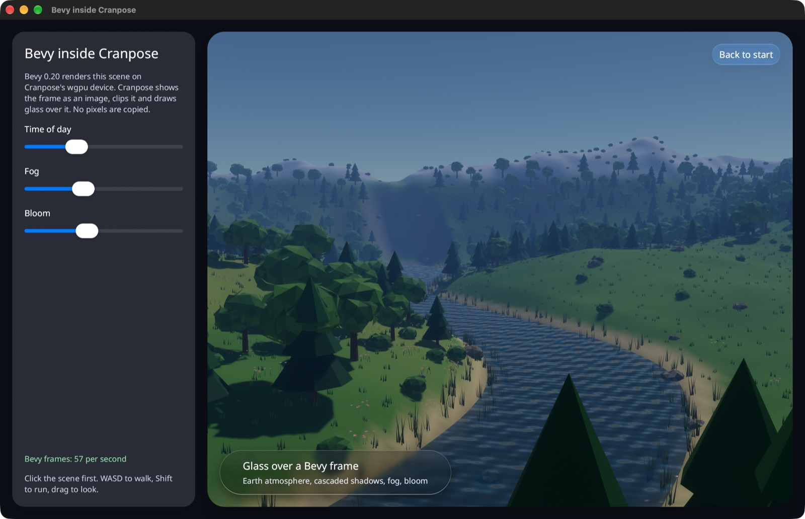
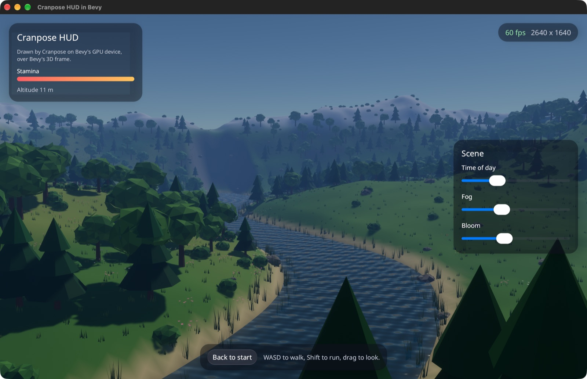
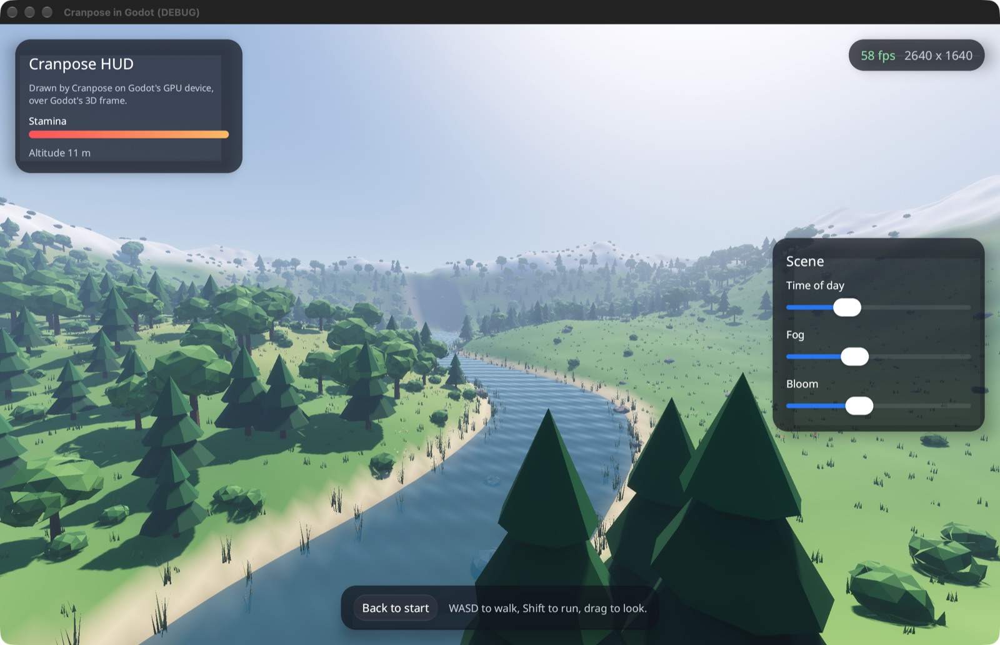

# Cranpose with game engines

[Cranpose](https://github.com/samoylenkodmitry/Cranpose) and game engines on
one GPU device, in both directions: an engine's 3D scene inside a Cranpose
layout, and a Cranpose interface over an engine's scene. Frames pass between
them as GPU textures; no pixels go through the CPU.

| | Bevy 0.20 | Godot 4.7 |
| --- | --- | --- |
| The engine's scene inside Cranpose | `cranpose_bevy::BevyScene` | the `godot` example's `window.tscn` |
| A Cranpose HUD over the engine | `cranpose_bevy::hud::CranposeHudPlugin` | `cranpose_godot::Surface` |
| A Cranpose screen in the engine's world | `cranpose_bevy::screen::CranposeScreen` | |








## Try it

All four examples run in the browser at
[samoylenkodmitry.github.io/cranpose-engines](https://samoylenkodmitry.github.io/cranpose-engines/).
The Bevy examples run on WebGPU where the browser has it (Chrome, Edge,
Safari 26), and on WebGL2 elsewhere, with a plain sky in place of the
atmosphere, which needs compute shaders. The Godot examples are Godot 4.7's
web export, which runs on WebGL2: the Cranpose extension runs inside it as
an Emscripten module and draws on Godot's own WebGL2 context, so Cranpose and
Godot share their textures without copies. On a phone the controls go under
the view, and a stick walks.

Each [release](https://github.com/samoylenkodmitry/cranpose-engines/releases)
has the two Bevy examples for macOS, Linux and Windows, and the Godot example
project for macOS. All four show the same valley: a winding river, trees,
flower meadows, grass and rocks, closed by mountains. Walk with WASD or the
arrow keys, run with Shift, and drag to look. Inside a Cranpose window, click
the scene first so it has the keyboard focus. In every example someone left
an office down on the river's bank, as in the backrooms: an old desk with a
tube monitor, a fallen chair, and a piece of yellow wall with a flickering
light. Walk down to the desk: the monitor's green screen is a Cranpose
composition on a mesh in the engine's world, and within reach its keys change
the light. Inside a Cranpose window, the view hands the pointer to the
engine's world, so the monitor takes the clicks there too.

The macOS builds are not signed, so macOS asks before it opens one the first
time: allow it in System Settings, Privacy & Security. The Godot example needs
[Godot 4.7](https://godotengine.org/download) with its Metal driver; unzip it
and open `res://hud.tscn` (a HUD over Godot's scene) or `res://window.tscn`
(Godot's scene inside a Cranpose window):

```bash
godot --path cranpose-engines-godot-macos-arm64 res://hud.tscn
```

## Start a project

Each folder in [`templates`](templates) is a project to copy and rename:

| Template | Start from | You get |
| --- | --- | --- |
| [`cranpose-app-with-bevy`](templates/cranpose-app-with-bevy) | Cranpose | A desktop app whose layout shows a Bevy scene next to Cranpose controls. |
| [`bevy-game-with-cranpose-hud`](templates/bevy-game-with-cranpose-hud) | Bevy | A Bevy game with a Cranpose HUD that reads and changes game state. |
| [`godot-game-with-cranpose-hud`](templates/godot-game-with-cranpose-hud) | Godot | A Godot project with a Rust extension that draws a Cranpose HUD. macOS. |

```bash
git clone --depth 1 https://github.com/samoylenkodmitry/cranpose-engines
```

```bash
cp -R cranpose-engines/templates/cranpose-app-with-bevy my-app
```

```bash
cargo run --manifest-path my-app/Cargo.toml
```

Each template keeps the engine code and the interface code in separate files,
and its README says what to change first.

## Add to an existing project

The crates are on crates.io:

```toml
[dependencies]
cranpose-bevy = "0.1.9"
```

A Godot extension depends on `cranpose-godot = "0.1.9"` instead.

On macOS, Windows and Linux that is all: Cranpose takes crates.io's wgpu
there, the one Bevy builds against. A web build of a Bevy project also
resolves crates.io's wgpu to the fork Cranpose uses in browsers:

```toml
[patch.crates-io]
wgpu = { git = "https://github.com/samoylenkodmitry/cranpose-engines", tag = "v0.1.9" }
```

- **A Bevy scene in a Cranpose app.** Ask the window's device for Bevy's
  features with `AppLauncher::with_gpu_requirements(cranpose_bevy::gpu_requirements())`.
  `rememberBevyView(setup)` starts Bevy on its own thread with your `setup`,
  which adds the scene and gives its camera the render target Cranpose shows.
  `BevyScene(modifier, view)` shows it, and `view.send(|world| ...)` changes
  Bevy's world from the interface. If your build also turns on Bevy's
  `bevy_winit`, for a game window, turn on `cranpose-bevy`'s `bevy_winit`
  feature too: Bevy's thread then runs without the window plugin.
- **A Cranpose HUD in a Bevy game.** Add `CranposeHudPlugin::new(content)` and
  put `HudCamera` on the camera the HUD draws over. `content` gets Bevy's world
  once, to share state with the game, and returns the HUD's root composable.
  `CranposeInput` tells the game whether a Cranpose surface took the
  pointer, a finger or the keys.
- **A Cranpose screen in a Bevy world.** Add `CranposeScreenPlugin` and give
  an entity a `Mesh3d` with UVs and a `CranposeScreen::new(size, density,
  content)`. The plugin gives the mesh a material that shows the composition,
  and sends it the pointer, the fingers and the keys that land on it:

  ```rust
  commands.spawn((
      Mesh3d(meshes.add(Rectangle::new(1.6, 1.0))),
      Transform::from_xyz(0.0, 1.5, -3.0),
      CranposeScreen::new(Vec2::new(512.0, 320.0), 2.5, |_world| {
          Box::new(|| MyTerminal())
      }),
  ));
  ```
- **A Cranpose HUD in Godot.** Depend on `cranpose-godot` (no patch needed),
  declare the extension with `cranpose_godot::godot_extension!(Extension)`, and
  give a node a `Surface` on a `CanvasLayer`. Call `draw` each frame and pass
  input events to `input` first. `Surface::viewport_frame` gives the
  composition a `SubViewport`'s frames, for Godot's scene inside a Cranpose
  layout, and a `Screen` is a composition for a mesh's material, such as a
  computer's screen in the game.

## Build the examples

```bash
cargo run -p bevy-in-cranpose
```

```bash
cargo run -p cranpose-hud-bevy
```

```bash
cargo build -p cranpose-godot-demo
```

```bash
godot --path examples/godot/project res://window.tscn
```

```bash
godot --path examples/godot/project res://hud.tscn
```

The Godot projects keep
`.godot/extension_list.cfg`, so Godot loads the Rust extension without an
import first.

The web examples build with `scripts/build-web.sh` into `dist/web`, which any
static file server can serve. Each example has a WebGPU build in `pkg` and a
WebGL2 build in `pkg-webgl2`; the page loads the one the browser runs.

## Where it runs

- Bevy in both directions: macOS (Metal) is tested; the Linux and Windows
  builds use wgpu's Vulkan and D3D12 backends and are built by CI.
- Godot in both directions: macOS with Godot's Metal driver, and Godot's web
  export. The bridge imports Godot's Metal objects; Vulkan and D3D12 are not
  bridged yet.
- The web: the Bevy directions over WebGPU and WebGL2, tested in Chrome on
  Android and in WebKit. Bevy updates inside Cranpose's frame there, since a
  page has one thread. The Godot directions over WebGL2, tested in WebKit.

Progress and the open work are tracked in
[Cranpose#1412](https://github.com/samoylenkodmitry/Cranpose/issues/1412).

## How the device is shared

Bevy 0.20 builds against wgpu 30. Since Cranpose 0.16 every target, desktop
included, renders with Cranpose's fork of wgpu 30. [`wgpu-shim`](wgpu-shim) is
a package named `wgpu` that re-exports the fork, and a build of Bevy patches
crates.io's `wgpu` with it, so Bevy builds against the fork. Then Bevy and
Cranpose use one `wgpu::Device` type and one device, and frames pass between
them as textures, with no copies and no unsafe code. Cargo ignores a `[patch]`
entry that renames a package, so the re-export package is needed. This
workspace and the three templates patch on every target.

- **Bevy inside Cranpose.** `cranpose_bevy::BevyView` (which
  `rememberBevyView` starts and `BevyScene` shows) runs Bevy on a thread of its
  own, with Bevy's renderer on Cranpose's device
  (`cranpose::gpu_context()`). The composition calls `BevyView::show` once per
  frame: Bevy may run one more update, and the composition gets the newest frame
  Bevy finished. Frames pass through `cranpose::ExternalFrames`, a ring of at
  most four textures: Bevy's render world publishes a frame once its work is
  submitted, and a texture goes back to Bevy once Cranpose shows a newer frame
  and holds no bitmap of the old one. Neither side waits for the other, so the
  interface keeps its frame rate when Bevy's frames take longer. The app asks
  the window's device for Bevy's features with
  `AppLauncher::with_gpu_requirements`. Bevy's thread is not the main thread,
  so it runs without Bevy's window plugin.
- **Cranpose HUD in Bevy.** `cranpose_bevy::hud::CranposeHudPlugin` creates a
  `GuestView` on Bevy's device and draws the HUD over the camera marked with
  `HudCamera`. Cranpose draws on Bevy's main thread into one of two textures,
  only when the composition changed, while the render world reads the other.
  A pass after Bevy's upscaling blends the newest HUD over the camera's final
  image with premultiplied alpha, at the target's size from the same frame.
- **Cranpose screens in Bevy's world.** `cranpose_bevy::screen` draws each
  `CranposeScreen`'s composition into a texture on Bevy's device, on the main
  thread, only when it changed, and puts that texture into Bevy's render
  assets as the image of the screen's material. The material decodes
  Cranpose's sRGB bytes and lights nothing, as a screen gives off its own
  light. A ray from the camera through the pointer finds the nearest mesh;
  when that is a screen, the hit's UV places the pointer in the composition.
  Meshes without a CPU copy do not block the ray.
- **Input.** Presses go to the HUD first, then to the screen under the
  pointer, then to the game. A surface keeps the press it took until it
  lifts, takes one finger at a time, and gets the keys after the press that
  last landed on it. `CranposeInput` tells the game what the surfaces took,
  so the game can follow the other fingers.

## How Godot is bridged

Godot renders through its own Metal driver, so Cranpose cannot share its
`wgpu::Device`. `cranpose-gpu-interop`, the one crate here with unsafe code, builds
a wgpu device on Godot's `MTLDevice` from the handles
`RenderingDevice.get_driver_resource` returns.

Cranpose submits to a queue of its own. wgpu opens a Metal command buffer for
each pass and holds them until it submits, and Godot's queue allows 64
uncompleted command buffers, which Godot and a Cranpose frame with glass
together exhaust. Each frame, one command buffer on Godot's queue hands the
textures over:

- **Godot to Cranpose:** it waits for Cranpose's last frame, copies the
  `SubViewport` texture into a texture Cranpose samples, and signals an event
  that Cranpose's next submit waits for.
- **Cranpose to Godot:** it waits for the event Cranpose's frame signals and
  copies the frame into the texture a `TextureRect` shows. Godot's own command
  buffers that read it come later on the same queue, so Metal orders them
  after the copy.

The copies run on the GPU; no pixels pass through the CPU.

On the web, Godot 4.7's export runs on WebGL2 and loads Rust extensions as
Emscripten side modules, built with the web templates that have extension
support but no threads (`scripts/build-web.sh out godot`). Cranpose is built
for `wasm32-unknown-emscripten` and draws with wgpu's GL backend on the WebGL2
context Godot made current, so there is one context and nothing to copy:

- `cranpose_gpu_interop::gl` wraps the current context as wgpu's adapter.
  Godot's templates lack Emscripten's `emscripten_webgl_get_proc_address`, so
  the GL loader is a table of the WebGL entry points the module imports from
  Godot's main module (`scripts/gl-names.py`).
- **Cranpose to Godot:** the GL name of Cranpose's texture becomes a Godot
  texture through `RenderingServer.texture_create_from_native_handle`.
- **Godot to Cranpose:** the GL name of a `SubViewport`'s render target becomes
  a wgpu texture Cranpose samples where Godot drew it.
- After each Cranpose frame, the GL state goes back to what Godot expects:
  no bindings, the fixed-function tests off, default unpacking.

Godot's web templates abort on a Rust panic, since they have no wasm
exception support, so the extension builds with `panic = "abort"`.

## Release

1. Point the templates at the new tag with `scripts/set-template-tag.sh vX.Y.Z`
   and commit.
2. Push the tag. `release.yml` builds the downloads and attaches them to the
   tag's release, and `pages.yml` publishes the web examples.
